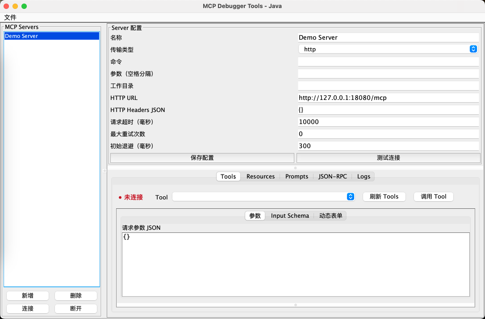
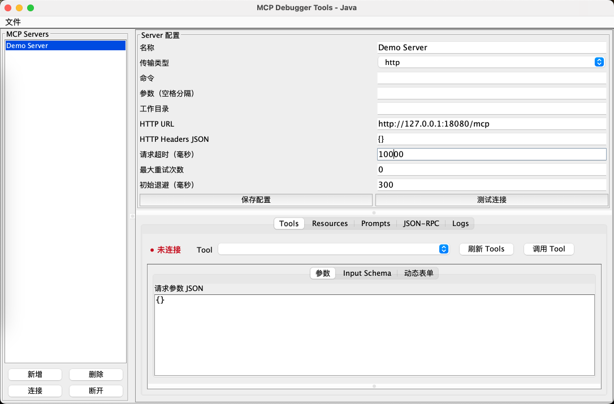

# mcp-debugger-tools-java

基于 Java 8/Swing 的 MCP 调试客户端。支持 Stdio 和基础 HTTP JSON-RPC、MCP 初始化、Tools、Resources、Prompts、原始通信日志和本地配置。

## 界面截图

主界面：



JSON-RPC 调试页：



## 环境

- JDK 8+
- Maven 3.6+

## 编译运行

```bash
mvn clean package
mvn exec:java
# 生成的是包含运行依赖的可执行 fat JAR，可直接运行
java -jar target/mcp-debugger-tools-java-0.1.0-SNAPSHOT.jar
```

也可以使用脚本：

```bash
sh scripts/run-debugger.sh
sh scripts/run-mock-http.sh 18080
```

Windows 用户可参考脚本中的 Java 命令执行，或使用 Maven 的 `exec:java`。

## 代码规范

项目使用 Spotless + Google Java Format（AOSP 风格）统一 Java 代码格式。修改代码后执行：

```bash
mvn spotless:apply   # 自动格式化
mvn spotless:check   # 检查格式，不修改文件
mvn verify           # 编译、测试并执行格式检查
```

格式检查绑定在 Maven `verify` 阶段，未格式化的代码不能通过完整构建。

Stdio 模式填写命令和参数；HTTP 模式选择 `http`，SSE 模式选择 `sse`，在 HTTP URL 中填写服务端 SSE 地址。需要认证时，在 HTTP Headers JSON 中填写例如 `{"Authorization":"Bearer your-token"}`。连接后可从 Logs Tab 查看原始请求、响应、HTTP 状态和耗时信息。

## 配置

配置文件默认位于 `~/.mcp-debugger/config.json`，支持名称、传输类型、命令、参数、工作目录、URL、Headers 和超时时间。当前支持 Stdio、基础 HTTP JSON-RPC 和基础 SSE。

也可以通过顶部“文件”菜单导入或导出 Server 配置 JSON。

## 启动 Mock MCP Server

打包后可以独立启动内置 Mock Server。

HTTP 模式：

```bash
java -cp target/mcp-debugger-tools-java-0.1.0-SNAPSHOT.jar com.example.mcpdebugger.mock.MockMcpServer --http 18080
```

调试器中填写：

```text
传输类型：http
HTTP URL：http://127.0.0.1:18080/mcp
```

Stdio 模式：

```text
命令：java
参数：-cp /绝对路径/target/mcp-debugger-tools-java-0.1.0-SNAPSHOT.jar com.example.mcpdebugger.mock.MockMcpServer
```

Mock Server 提供 `initialize`、Tools、Resources、Prompts 和 Tool `echo` 调用，可用于手动测试界面。

## 文档

实现过程和每个阶段的设计记录见 [docs/implementation-log.md](docs/implementation-log.md)。

博客初稿见 [docs/blog/mcp-debugger-java8.md](docs/blog/mcp-debugger-java8.md)，测试清单见 [docs/test-cases.md](docs/test-cases.md)。
